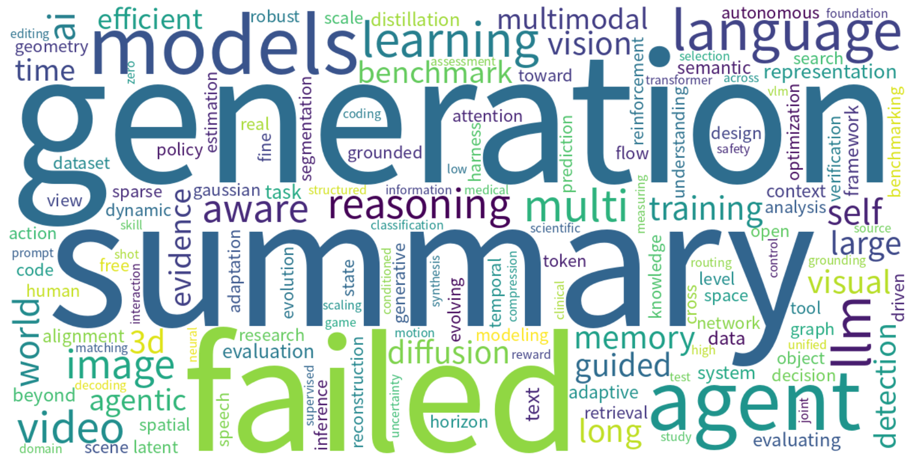

# Monthly arXiv Review — October 2026

**Period:** 2026-10-01 to 2026-10-31  
**Total papers:** 8753  
**Active weeks:** 5  

---

## 📈 Paper Volume Ranking by Category

| Rank | Category | Papers | Share |
| ---: | -------- | -----: | ----: |
| 1 | cs.CV | 3231 | 36.9% |
| 2 | cs.AI | 2726 | 31.1% |
| 3 | cs.CL | 2032 | 23.2% |
| 4 | cs.IT | 408 | 4.7% |
| 5 | cs.GT | 210 | 2.4% |
| 6 | cs.CE | 146 | 1.7% |

---

## ☁️ Research Hotspot Word Cloud

*The word cloud above visualizes the most frequently appearing research topics and concepts across all papers this month.*

---

## 📅 Weekly Hotspot Evolution

| Week | Papers | Top Research Topics |
| ---- | -----: | ------------------- |
| 2026-W40 | 932 | — |
| 2026-W41 | 2159 | — |
| 2026-W42 | 1823 | — |
| 2026-W43 | 2114 | — |
| 2026-W44 | 1725 | — |

---

## 🤖 AI-Generated Monthly Trend Analysis

Trend analysis generation failed.

---

*Generated automatically on 2026-11-01 11:44 UTC*